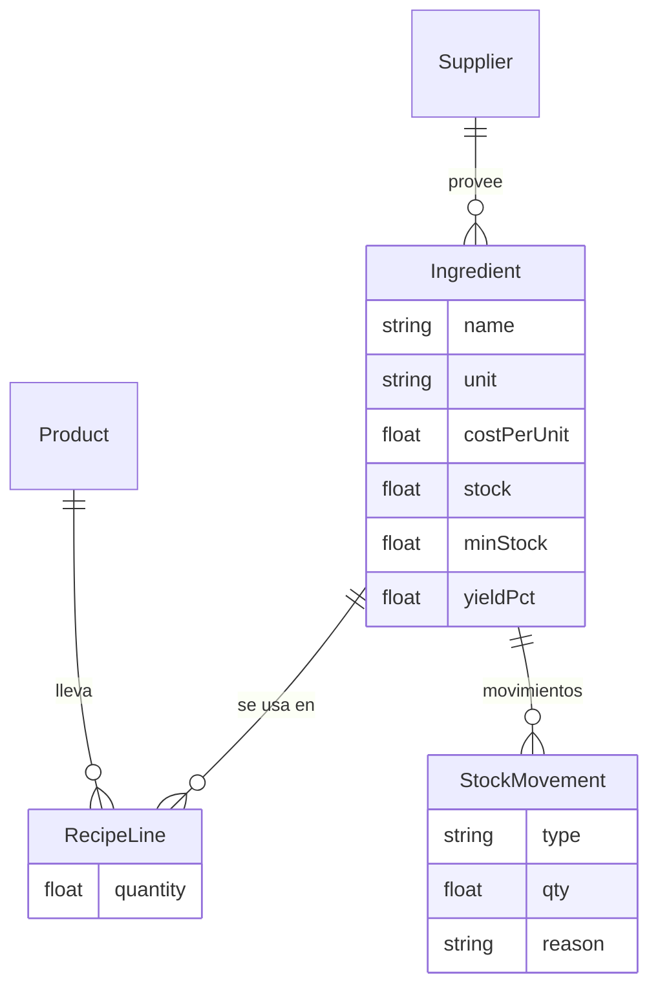

# Auditoría Yankun Sushi Lab

**Alcance revisado:** `prisma/schema.prisma`, las 11 rutas `src/app/api/**`, `lib/*`, las 9 páginas admin, las páginas cliente (carrito, menú, pedido), PRD y la base Supabase en vivo (políticas RLS y advisors).
**No revisé:** las pantallas de `assets_originales` (son maquetas HTML) ni probé el flujo en runtime.

---

## 1. Hallazgos críticos (corregir antes de vender en producción)

| # | Hallazgo | Evidencia | Corrección |
|---|---|---|---|
| C1 | **La base está abierta a internet.** Las tablas `User`, `Order`, `Customer`, `ChatMessage`, `Product` y `StoreSetting` tienen una política `ALL … USING (true)` para el rol `public`. Con la anon key (visible en el navegador) cualquiera puede leer o editar pedidos y teléfonos de clientes. También puede leer `User.passwordHash`, cambiar precios o marcar pedidos como pagados. | Consulta a `pg_policies`: "App Manage Orders/Users/Customers…" | Quitar las políticas `App Manage *`. Dejar al público solo `SELECT` en catálogo, zonas y settings públicos. Hacer todas las escrituras desde el servidor con `SUPABASE_SERVICE_ROLE_KEY` (nunca `NEXT_PUBLIC`). |
| C2 | **La anon key y el JWT secret tienen valores por defecto en el código.** Si falta la variable de entorno, se usa la key hardcodeada o `'yankun_super_secret_jwt_key_2026_shokunin'`. | [supabase.ts](file:///c:/Users/Carlos%20Diaz/Desktop/SUSHI/src/lib/supabase.ts), [auth.ts](file:///c:/Users/Carlos%20Diaz/Desktop/SUSHI/src/lib/auth.ts) | Eliminar los fallbacks y fallar al arrancar si falta la variable. Rotar `JWT_SECRET`. Un secret conocido permite falsificar sesiones de SUPERADMIN. |
| C3 | **No hay `middleware.ts` ni verificación de sesión en las APIs.** `/api/admin/products` (PATCH de precios), `/api/orders/[id]` (PATCH de estado y pago), `/api/zones` (DELETE) y `/api/orders` (GET con datos de todos los clientes) funcionan sin login. | No existe `middleware.ts`. Ninguna ruta llama a `getAdminSession()`. | Agregar middleware para `/admin/**` y `/api/admin/**`. Validar el rol en cada mutación. Separar `GET /api/orders` público (solo por id) del listado admin. |
| C4 | **Login con credenciales por defecto y PIN fijo.** Hay fallback `admin@yankunsushi.com / adminYankun2026!` y PIN `888888`, ambos en `.env.example` y en el código. No hay rate limit, así que un PIN de 6 dígitos se fuerza en minutos. La comparación no es de tiempo constante. | [auth/route.ts](file:///c:/Users/Carlos%20Diaz/Desktop/SUSHI/src/app/api/admin/auth/route.ts) | Quitar el usuario hardcodeado y usar la tabla `User` con bcrypt. Rate limit y bloqueo por intentos. PIN por dispositivo, revocable, con rol limitado a cocina. |
| C5 | **El cliente decide cuánto paga y si está pagado.** `POST /api/orders` confía en `subtotal`, `total`, `price` y `deliveryFee` del navegador. Con `MERCADO_PAGO` marca `paymentStatus: 'APROBADO'` sin verificar nada. | [orders/route.ts](file:///c:/Users/Carlos%20Diaz/Desktop/SUSHI/src/app/api/orders/route.ts) L758-780 | Recalcular precios en servidor desde `Product` y los modificadores. Crear siempre como `PENDIENTE`. Pasar a `APROBADO` solo desde el webhook. |
| C6 | **El webhook de Mercado Pago no hace nada.** Solo hace `console.log` y deja el update comentado. No valida la firma `x-signature` ni consulta el pago en la API de MP. Un pago real no confirma el pedido. | [webhooks/mercadopago](file:///c:/Users/Carlos%20Diaz/Desktop/SUSHI/src/app/api/webhooks/mercadopago/route.ts) | Validar HMAC con `MP_WEBHOOK_SECRET`. Consultar `payment.get(id)`, buscar la orden por `external_reference` y actualizarla de forma idempotente. Registrar el `payment_id`. |
| C7 | **El webhook de WhatsApp no valida `X-Hub-Signature-256`.** Cualquiera puede inyectar mensajes falsos. `META_APP_SECRET` está en `.env` pero no se usa. El verify token tiene fallback hardcodeado. | [webhooks/whatsapp](file:///c:/Users/Carlos%20Diaz/Desktop/SUSHI/src/app/api/webhooks/whatsapp/route.ts) | Validar el HMAC sobre el body crudo. Quitar el fallback del token. |

---

## 2. Bugs de lógica de negocio

1. **Pedido sin transacción.** Cliente → Order → OrderItems son tres inserts separados. Si fallan los items, queda una orden vacía. Además `ordersCount` y `totalSpent` se calculan leyendo y escribiendo, lo que genera condiciones de carrera. Conviene una función RPC/transacción de Postgres que haga todo atómico.
2. **Estadísticas de cliente infladas.** `totalSpent` se suma al *crear* el pedido, aunque después se cancele o no se pague. Debe sumarse al estado `ENTREGADO` (o pagado).
3. **Enum de estados incompleto vs PRD.** El schema solo tiene `CREADO, EN_COCINA, EN_CAMINO, ENTREGADO, CANCELADO`. El PRD pide `PENDIENTE_PAGO`, `PAGADO_CONFIRMADO`, `PENDIENTE_VERIFICACION` y "Listo para despacho". Sin eso no se puede separar "no pagó" de "en cocina".
4. **`PATCH /orders/[id]` acepta cualquier transición** (por ejemplo `ENTREGADO → CREADO`) y no guarda quién la hizo. La BD ya tiene `order_status_history`, pero la app no la usa.
5. **Dos modelos de datos en paralelo.** La BD tiene tablas `orders`, `order_items`, `products`, `categories`, `delivery_zones` y `business_settings`, además de las `Order`, `Product`, etc. del código. Hay duplicación, y `order_daily_counters` no tiene políticas. Hay que decidir un solo esquema, porque el `schema.prisma` ya no refleja la base real.
6. **"Local Abierto/Cerrado" es solo estado local de React.** No se persiste, así que el cliente puede seguir pidiendo con el local cerrado.
7. **`customersCount` del dashboard es `orders.length`**, es decir, cuenta pedidos y no clientes. Y "ventas de hoy" incluye pedidos cancelados.
8. **Omnicanal y Bot IA son maquetas.** `omnicanal/page.tsx` usa `INITIAL_CONVERSATIONS` y números con `Math.random()`. `bot-ia/page.tsx` simula con `setTimeout`. El webhook guarda mensajes entrantes, pero la UI no los lee ni se puede responder. Tampoco hay envío saliente.
9. **Geolocalización simulada en el carrito.** `cart/page.tsx` L70 asigna coordenadas "según palabras clave" en vez de geocodificar. La zona de envío y su costo pueden quedar mal.
10. **Extras con precio hardcodeado en el front** (`ProductCustomizerModal` L278: palta $950, masago $1400…). No están en la BD ni en el costeo.
11. **Los slugs de producto usan `Date.now()`**, y el regex no maneja tildes ni ñ ("Salmón" → "salm-n").
12. **Problemas de codificación** (mojibake `Ǹ`, `�`) en `printer.ts`, la ruta de chat IA y el PRD. Guardar todo en UTF-8 y usar `codepage` CP858 para ESC/POS.
13. **`generateKitchenTicketText` existe pero no se usa.** La cocina imprime con `window.print()` de un HTML. Funciona, pero no hay ticket ESC/POS ni de despacho como pide el PRD.

---

## 3. Rendimiento

| Problema | Impacto | Solución |
|---|---|---|
| `GET /api/orders` trae **todos** los pedidos históricos con items, sin paginar ni filtrar por fecha. Lo usan el dashboard y la cocina, esta última cada 6 s con `setInterval`. | Crece sin límite. Cuando haya miles de pedidos, cada tablet y cada pestaña lo descarga completo. | Filtrar por rango de fecha y estado, paginar. Para cocina traer solo estados activos. Quitar el polling porque ya existe Realtime. Para métricas, usar una **vista/RPC de agregación en SQL** en vez de calcular en el navegador. |
| El dashboard calcula todo en cliente con `reduce`. | Lento y inexacto con volumen. | RPC `dashboard_metrics(from, to)`. |
| Todas las páginas admin son `'use client'` con `fetch` en `useEffect`. | Sin caché, con parpadeo de carga. | Server Components para lecturas, o SWR/React Query con revalidación. |
| Dos clientes de datos (Prisma y supabase-js) y Prisma casi sin uso. | Peso y confusión. | Elegir uno. Con Supabase, Prisma solo para migraciones, o eliminarlo. |
| Falta de índices probables: `Order(createdAt)`, `Order(status)`, `OrderItem(orderId)`, `ChatMessage(customerPhone, createdAt)`. | Consultas más lentas. | Crear índices. Prisma no los crea automáticamente en las FKs. |
| `index.html` de 96 KB y `screen.png` de 500 KB en la raíz. | Ruido en el repo. | Mover a `assets_originales` o borrar. |
| Imágenes de producto como URL plana. | LCP lento en móvil. | `next/image` con tamaños, y Supabase Storage con transformaciones. |

---

## 4. Conectores

### 4.1 Chatbot (`/api/chat/ai`)
- Hoy es un `if/includes` con respuestas fijas y no usa el catálogo real. Una frase como "recomendame algo" devuelve siempre el "Omakase Signature Roll" aunque no esté disponible.
- **Mejora recomendada, por prioridad:**
  1. Conectar la ruta al catálogo real: productos activos, precios, tags (GF, VEGGIE), horario y zonas.
  2. Usar el AI SDK con un modelo económico (Gemini Flash o similar) con herramientas: `buscarProducto`, `estadoPedido(telefono)`, `zonaYCostoEnvio(direccion)`, `armarLinkDePedido`.
  3. Guardrails: las consultas de alergia derivan a humano, **pero con aviso claro al cliente y al panel**. El bot nunca debe afirmar "apto celíaco" por su cuenta.
  4. Persistir `bot_active` por conversación (el PRD lo pide, pero no existe en `ChatMessage`; hace falta una tabla `Conversation`).
  5. Registrar si el bot resolvió o derivó, para medir **tasa de resolución**.

### 4.2 Medios de pago
- Corregir C5 y C6 (son la base).
- Agregar **transferencia con comprobante**: el campo `paymentProofUrl` existe, pero falta el estado `PENDIENTE_VERIFICACION` y la pantalla del operador para ver el comprobante y aprobar.
- **Descuento por transferencia o efectivo** configurable (muy habitual en Argentina, porque compensa la comisión de MP).
- Cobro del **saldo de efectivo**: campo "paga con $X" y cálculo de vuelto en el ticket.
- **Reembolso** desde el panel (la API de MP lo permite) cuando se cancela un pedido pagado.
- **Conciliación**: reporte diario de ventas por medio de pago y comisión estimada de MP.
- Expiración de pagos pendientes (por ejemplo 30 min) para liberar la comanda.

### 4.3 Inbox omnicanal WhatsApp + Instagram
- Falta casi todo el ciclo real: **recepción → conversación → respuesta saliente**. Pasos mínimos:
  1. Tabla `Conversation` (canal, contacto, `bot_active`, asignado a, último mensaje, no leídos) y relación con `Customer`.
  2. Guardar `wa_message_id` para **deduplicar** (Meta reintenta) y procesar estados `sent/delivered/read`.
  3. Endpoint de envío saliente (`/messages` de WhatsApp Cloud API) respetando la **ventana de 24 h**. Fuera de ella solo se pueden enviar plantillas aprobadas.
  4. Instagram: el webhook no existe todavía. Hay que agregarlo con la misma validación de firma.
  5. UI con Supabase Realtime, sonido de alerta al derivar a humano y vincular el contacto con su historial de pedidos.
  6. **Botón "Crear pedido desde chat"**: la maqueta ya lo insinúa, y es la función más valiosa para un local chico.
- Procesar el mensaje de forma asíncrona y responder 200 rápido. Hoy el insert ocurre dentro del request y solo procesa `messages[0]`, **perdiendo mensajes si llegan varios en un mismo webhook**.

### 4.4 Automatizaciones recomendadas (viables y de bajo costo)
| Disparador | Acción |
|---|---|
| Pedido confirmado | Mensaje de WhatsApp (plantilla) con número y tiempo estimado |
| Estado `EN_CAMINO` | Aviso con link de seguimiento `/pedido/[id]` |
| Pedido `ENTREGADO` + 60 min | Pedir calificación 1-5 |
| Cliente sin pedir 21 días | Cupón de reactivación (segmento "dormidos") |
| Pedido de cocina > 30 min | Alerta al encargado |
| Stock de insumo bajo mínimo | Aviso al dueño y marcar el producto como "agotado" automáticamente |
| Local cerrado | Respuesta automática con horarios |
| Carrito abandonado | Recordatorio (solo si hay consentimiento) |

Implementación simple: **Vercel Cron o Supabase pg_cron** más una tabla `automation_log` para evitar envíos duplicados.

---

## 5. CRM: métricas recomendadas

### Fase 1 — con los datos que ya tienes (1-2 días)
- Ventas por hora, día de la semana y mes; **comparativa vs semana anterior (%)**.
- **Ticket promedio**, pedidos por canal (web / WhatsApp / Instagram) y delivery vs retiro.
- **Margen bruto por producto** (ya existe `costPrice`): ranking de productos por margen y por volumen. Marcar los de **alto volumen y bajo margen**.
- Producto estrella y producto "hueso" (muchas vistas, pocas ventas).
- Tiempo promedio de preparación (`CREADO → EN_COCINA → EN_CAMINO → ENTREGADO`), y % de pedidos que superan el tiempo prometido. **Requiere guardar timestamps por estado** (usar `order_status_history`).
- Tasa de cancelación y su motivo.
- Zonas más rentables: ventas menos costo de envío por zona.
- Clientes nuevos vs recurrentes, tasa de recompra a 30 días, **top clientes**.
- Medios de pago: mezcla y comisión estimada.
- Mapa de calor de pedidos por zona.

### Fase 2 — "tiempo real"
- Tarjetas del dashboard actualizadas con Supabase Realtime (ya está en cocina): pedidos activos, ventas del día vs ayer a la misma hora, **tiempo medio de espera ahora**, pedidos atrasados.
- Cuenta de conversaciones sin responder y tiempo de primera respuesta.

---

## 6. Cocina de sushi: control de materia prima (la mejora más valiosa)

Hoy `costPrice` es **un solo número cargado a mano** por producto. No se sabe cuánto salmón, arroz o alga se consume, ni cuándo se acaba.

### Modelo propuesto

- **Ingredient**: salmón, atún, arroz, nori, palta, queso crema, cebolla de verdeo, sésamo, vinagre de arroz, wasabi, jengibre, soja, etc. Con unidad (kg, g, unidad), costo por unidad, stock actual, stock mínimo y proveedor.
- **RecipeLine** (escandallo): cuántos gramos de cada insumo lleva cada producto. Puede incluir las **opciones de personalización** (extras como palta o masago con su propia receta).
- **StockMovement**: compras (+), consumo por venta (−), **merma** (−) y ajuste de inventario.
- **`costPrice` pasa a calcularse automáticamente** desde la receta. Cuando sube el precio del salmón, se recalcula el margen de todo el menú.

### Qué métricas se obtienen
1. **% de materia prima por producto** (food cost %): costo de ingredientes ÷ precio. El objetivo habitual en sushi es **28-35%**. Se marca en rojo lo que lo supere.
2. **Reparto del costo por insumo**: por ejemplo, "en el Omakase Roll el salmón es el 54% del costo". Útil para decidir sustituciones.
3. **Consumo teórico diario**: kg de salmón, arroz y nori usados según las ventas del día.
4. **Merma real vs teórica**: conteo físico de cierre menos consumo teórico. Detecta desperdicio, porciones excesivas o robo. En sushi el rendimiento del pescado limpio ronda el 55-70%, por eso conviene el campo `yieldPct`.
5. **Stock proyectado y alertas**: "con las ventas de los últimos 7 días, el salmón alcanza para 1,8 días".
6. **Lista de compras sugerida** para el día siguiente según demanda histórica por día de la semana.
7. **Auto-pausa de productos** cuando un insumo crítico se agota.
8. **Ingeniería de menú**: matriz popularidad × margen (estrella / caballo / puzzle / perro).
9. **Evolución del costo de insumos** en el tiempo, para ajustar precios ante inflación (fundamental en Argentina). Una alerta "el costo de este producto subió 12% desde que fijaste el precio" es muy útil.
10. **Producción por lote**: preparación de arroz (kg de arroz crudo → kg de shari), que es el punto de mayor variabilidad.

### Otras ideas viables para el negocio
- **Combos con precio dinámico** según margen objetivo.
- **Horario pico**: preparar mise en place según la demanda por franja.
- **Ventas por categoría** (rolls, nigiri, combos, bebidas) y venta cruzada (por ejemplo, qué se pide junto con qué).
- **Packaging como insumo** (cajas, bolsitas de soja, palitos): suele olvidarse en el costo y erosiona el margen del delivery.
- **Costo de delivery** (cadete o combustible) imputado por zona para ver la rentabilidad real.
- **Calificaciones** de clientes por producto.
- **Cierre de caja diario** (efectivo, MP, transferencia) con diferencia esperada vs real.
- **Alérgenos por producto** (tabla o tags) para que el bot pueda responder con datos y la cocina los vea en la comanda.

---

## 7. Plan sugerido

| Fase | Contenido | Esfuerzo estimado |
|---|---|---|
| **0 — Seguridad (ya)** | C1-C7: RLS, service role en servidor, middleware, sin credenciales por defecto, precios en servidor, webhooks con firma | 2-3 días |
| **1 — Integridad** | Estados completos, transacción de pedido, `order_status_history`, local abierto/cerrado persistente, unificar esquema, índices, paginación | 2-3 días |
| **2 — Métricas básicas** | RPC de agregación y dashboard con la Fase 1 de §5 | 2 días |
| **3 — Inventario y recetas** | Ingredientes, recetas, movimientos, food cost %, alertas de stock | 4-6 días |
| **4 — Inbox real + bot con catálogo** | Conversaciones, envío saliente, Instagram, bot con herramientas | 5-7 días |
| **5 — Automatizaciones y pagos avanzados** | Plantillas WhatsApp, transferencias con comprobante, reembolsos, reactivación | 3-5 días |

> [!IMPORTANT]
> Las fases 0 y 1 no son opcionales. Mientras C1 y C3 sigan abiertos, cualquier persona con la URL puede ver los datos de tus clientes o cambiar precios. Si ya hay datos reales cargados, **rota la anon key y el `JWT_SECRET`**, porque ambos estuvieron expuestos en el código.

> [!NOTE]
> Los esfuerzos son estimaciones mías para un desarrollador. No ejecuté pruebas en runtime ni cambié ningún archivo del proyecto. Esta auditoría es solo de lectura.
