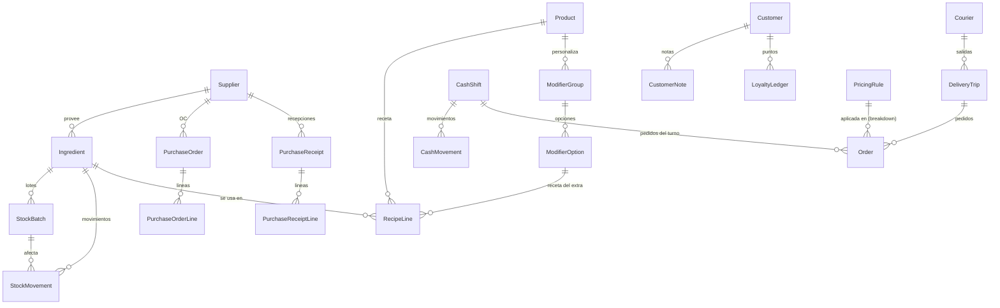
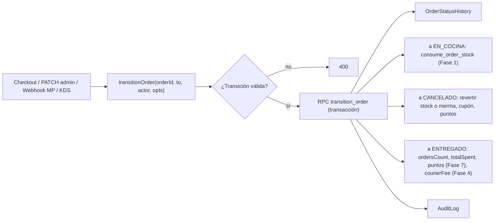

# Yankun Sushi Lab — Auditoría 2 y prompt de evolución ERP (inspirado en ERPNext)

> **Cómo usar este archivo**
> 1. Pegá primero el bloque **"PROMPT MAESTRO"** (sección 3) en una conversación nueva de Antigravity.
> 2. Después pegá **una fase por vez** (sección 5), en orden. No avances a la siguiente fase hasta que se cumplan todos los criterios de aceptación de la actual.
> 3. Cada fase termina con `npm run build` sin errores, `npx vitest run` en verde y el checklist manual completo.

---

## 1. Auditoría 2: resumen

### 1.1 Qué se tomó de ERPNext y qué se descartó

ERPNext (https://github.com/frappe/erpnext) es un ERP completo (contabilidad, manufactura, RR.HH., proyectos, etc.). Para un local de sushi delivery con 2 a 8 personas en Bahía Blanca, se adaptan **solo los conceptos de mayor retorno**, reimplementados con el stack actual (Next.js 15 + Supabase). **No se instala ERPNext ni Frappe.**

| Concepto ERPNext (DocType) | Adaptación en Yankun | Dónde vive en la UI |
|---|---|---|
| Item, Warehouse, Stock Ledger Entry, Batch | Insumos, movimientos de stock, lotes con vencimiento (FEFO) | Nuevo ítem del sidebar **Inventario** |
| BOM (multinivel), Work Order | Recetas o escandallo por producto y por extra, y preparaciones intermedias (Shari, Pescado limpio) con producción por lote | Pestaña **Recetas** en Catálogo & Escandallo, y pestaña **Producción** en Inventario |
| Stock Reconciliation | Conteo físico semanal, merma real vs teórica | Inventario → pestaña **Conteos** |
| Supplier, Purchase Order, Purchase Receipt, Item Price | Proveedores, orden de compra (se envía por WhatsApp), recepción con lote y precio real, historial de precios | Inventario → pestaña **Compras** |
| Material Request (auto re-order) | Lista de compras sugerida | Inventario → Compras → **Sugerido** |
| POS Opening Entry / POS Closing Entry | Turno de caja (apertura con fondo, egresos, cierre con conteo y diferencia) | Nuevo ítem del sidebar **Caja & Reparto** |
| Delivery Trip, Driver | Cadetes (sin login), salidas con varios pedidos, rendición de efectivo, pago por viaje según la zona | Botón en la tarjeta del KDS y Caja & Reparto → pestaña **Reparto** |
| Customer, CRM, Customer Group | Ficha 360°, notas, etiquetas, alergias, cumpleaños, segmentos RFM, consentimiento de marketing | Nuevo ítem del sidebar **Clientes**, y panel lateral en Omnicanal |
| Pricing Rule, Promotional Scheme, Coupon Code | Motor de reglas de precio (medio de pago, happy hour, NxM, envío gratis, segmento o nivel) que convive con los cupones | Configuración → pestaña **Reglas de precio** |
| Loyalty Program | Puntos con vencimiento, niveles Bronce, Plata y Oro, canje con OTP | Configuración → pestaña **Fidelidad**, y una fila en el carrito |
| Version / Audit Trail | Tabla `AuditLog` | Configuración → pestaña **Auditoría** |
| Report Builder / Query Reports | Reportes: food cost, ingeniería de menú, rentabilidad por zona, consumo teórico vs real | Pestañas dentro de **Dashboard CRM** |

**Quedan fuera de este roadmap (backlog, sección 6):** RR.HH. y turnos de personal, facturación electrónica ARCA/AFIP, contabilidad (P&L), campañas masivas, inbox real con bot IA e Instagram.

### 1.2 Pendientes de la Auditoría 1 que siguen abiertos (se resuelven en la Fase 0)

| # | Hallazgo | Evidencia |
|---|---|---|
| A2-1 | La anon key, la URL, `JWT_SECRET` y `INTERNAL_SERVER_SECRET` siguen teniendo **valores por defecto en el código**. | `src/lib/supabase.ts`, `src/lib/supabaseServer.ts`, `src/middleware.ts` (L4), `src/lib/auth.ts` |
| A2-2 | `supabaseServer` usa la **anon key** con un header `x-server-auth` que valida RLS. Si el secreto por defecto es conocido, cualquiera obtiene permisos de admin. | `src/lib/supabaseServer.ts` |
| A2-3 | Los precios de los extras están **fijos en dos lugares**: front (`ProductCustomizerModal.tsx` L278-281) y back (`api/orders/route.ts` L116-121). El back usa `Number(extra.price)` del cliente como fallback, así que el cliente puede inyectar precios en extras desconocidos. | idem |
| A2-4 | **Creación de pedido no atómica.** El cupón se incrementa (L230) **antes** de insertar la orden, los items se insertan sin verificar el error (L332) y el stock se descuenta con lectura y escritura separadas (condición de carrera). | `api/orders/route.ts` |
| A2-5 | `ordersCount` se incrementa al **crear** el pedido (L275), pero debe sumarse al pasar a `ENTREGADO`, igual que `totalSpent`. | idem |
| A2-6 | La lógica de transición de estado está **solo** en `PATCH /api/orders/[id]`. El checkout (efectivo pasa directo a `EN_COCINA`) y el webhook de MP cambian estados por su cuenta. Sin un servicio central no se pueden enganchar stock, puntos ni caja. | `api/orders/[id]/route.ts`, `api/webhooks/mercadopago/route.ts` |
| A2-7 | **Mojibake (UTF-8 roto)** en el middleware, el webhook de MP, `printer.ts` y el customizer (`tibur�n`, `Sesi�n`). | varios |
| A2-8 | **Tablas heredadas snake_case** sin uso: `orders`, `order_items`, `products` (31 filas), `categories`, `delivery_zones`, `business_settings`, `business_hours`, `admin_users`, `food_truck_events`, `sales_locations`, `special_events`, `order_status_history`, `order_daily_counters` (sin RLS). | Supabase en vivo |
| A2-9 | El webhook de MP **solo valida la firma si los headers están presentes**. Si falta `x-signature`, igual procesa el evento. | `api/webhooks/mercadopago/route.ts` L19 |
| A2-10 | Si la zona no existe, el envío pasa a `1200` por defecto: un pedido podría salir de un área sin cobertura. | `api/orders/route.ts` L193-196 |
| A2-11 | No hay framework de tests. | `package.json` |

### 1.3 Datos reales actuales (relevados en Supabase)
`Order`: 1 · `Product`: 8 · `Customer`: 1 · `Coupon`: 3 · `OrderStatusHistory`: 0. **Prácticamente no hay datos productivos**, así que las migraciones se pueden hacer sin riesgo de pérdida, siempre con un backup previo.

---

## 2. Decisiones acordadas (sesión /grill-me)

| # | Tema | Decisión |
|---|---|---|
| D1 | Escala | 1 local en Bahía Blanca, de 2 a 8 personas, cadetes propios. **Sin multi-sucursal ni multi-almacén** (un solo depósito lógico). |
| D2 | Módulos | Inventario + Recetas, Compras, Caja/Turno, CRM Clientes, Fidelidad + Reglas de precio, Reparto. |
| D3 | Impacto visual | **Máximo 3 ítems nuevos en el sidebar** (Inventario, Clientes, Caja & Reparto). El resto va en pestañas dentro de pantallas existentes, con los mismos componentes y tokens. |
| D4 | Datos | Las tablas PascalCase actuales son la única fuente de verdad. Prisma = esquema + migraciones SQL versionadas. supabase-js con **service role** solo en servidor. Las tablas snake_case se archivan y se borran. |
| D5 | Descuento de stock | Automático al pasar a `EN_COCINA`, según la receta (incluye extras y packaging). Si se cancela antes de cocina, no se toca el stock. Si se cancela después, el operador elige "se preparó → merma" o "no se preparó → devolver". Conteo físico semanal. |
| D6 | Lotes | Lotes con vencimiento para pescados, mariscos y palta. Consumo **FEFO** y alerta 24 h antes del vencimiento. |
| D7 | Recetas | Multinivel: preparaciones intermedias (Shari, Pescado limpio con rendimiento %). |
| D8 | Disponibilidad | `Product` disponible = porciones calculadas desde los insumos, con auto-pausa en 0. El stock manual queda solo para productos sin receta (bebidas). |
| D9 | Compras | Proveedor → OC opcional (se envía por WhatsApp) → Recepción con precio real y lote. |
| D10 | Costeo | **Último precio de compra.** Recalcula el food cost de todo el menú en cada recepción. |
| D11 | Caja | Un turno por servicio: apertura con fondo, egresos, cierre con conteo y diferencia. **Solo se aceptan pedidos con turno abierto.** |
| D12 | Local abierto | El interruptor "Local Abierto" pasa a ser **Abrir turno / Cerrar turno** (persistido). Con el local cerrado, la tienda muestra "Cerrado · abre a las HH:MM" y permite pedidos programados. |
| D13 | Cadetes | **Sin login.** El admin asigna y marca la entrega desde el KDS. La rendición de efectivo se hace en el cierre. |
| D14 | Pago a cadetes | Monto fijo por viaje configurable por zona, que se usa como costo de delivery en la rentabilidad por zona. |
| D15 | Fidelidad | 1 punto cada \$1.000 (se acredita al pasar a `ENTREGADO`). 100 pts = \$5.000. Vencen a los 6 meses. Niveles Bronce, Plata y Oro según el gasto de los últimos 90 días. |
| D16 | Reglas de precio | % por medio de pago, franja horaria o día, NxM, envío gratis sobre un monto, segmento o nivel. Prioridad, no acumulables por defecto, **siempre calculadas en el servidor**. |
| D17 | Identidad del cliente | Teléfono + **OTP de 6 dígitos por WhatsApp solo para canjear**. Consultar el saldo no pide OTP. Sin cuentas. |
| D18 | CRM | Ficha 360°, segmentos RFM automáticos y consentimiento de marketing en el checkout. |
| D19 | Mensajería | WhatsApp Cloud API **todavía no operativa**. Proveedor de mensajes intercambiable (driver `dev` / `whatsapp_cloud`). |
| D20 | Fase 0 | Obligatoria: saneamiento de la Auditoría 1 + `AuditLog`. |
| D21 | Entregable | Este archivo, una fase por vez. |
| D22 | Orden | 0 Saneamiento → 1 Inventario + Recetas → 2 Compras → 3 Caja → 4 Reparto → 5 CRM → 6 Reglas de precio → 7 Fidelidad + OTP → 8 Reportes. |
| D23 | Verificación | Vitest para la lógica pura, checklist manual en el navegador y `npm run build`. |

---

## 3. PROMPT MAESTRO (pegar primero, una sola vez)

```text
Sos el ingeniero principal de "Yankun Sushi Lab" (repo: c:\Users\Carlos Diaz\Desktop\SUSHI).
Vas a evolucionar el CRM/panel admin agregando funciones tipo ERP inspiradas en ERPNext,
SIN cambiar la estética del proyecto. Leé antes de empezar:
- docs/PROMPT_EVOLUCION_ERP.md (este plan, secciones 1, 2 y 4 completas)
- docs/ANTIGRAVITY_RULES.md, docs/PRD_YANKUN_SUSHI.md, DESIGN.md
- auditoria_yankun_sushi.md (Auditoría 1)
- prisma/schema.prisma, src/app/api/orders/route.ts, src/app/api/orders/[id]/route.ts,
  src/app/(admin)/admin/layout.tsx, src/app/(admin)/admin/cocina/page.tsx

STACK FIJO: Next.js 15 App Router + React 19 + TypeScript strict + Tailwind 3 (tokens existentes)
+ Supabase Postgres (proyecto cdhnpsowlsesoobrytvh) + supabase-js en servidor con SERVICE ROLE
+ Prisma solo para esquema/migraciones + zustand en el cliente + Material Symbols.
NO agregues librerías de UI, de estado ni ORMs nuevos. Sí podés agregar: vitest, zod.

REGLAS NO NEGOCIABLES
1. Visual: reutilizá exactamente las clases y patrones existentes (bg-surface, bg-surface-container*,
   bg-inverse-surface, text-on-surface, bg-primary, text-secondary-fixed, font-headline, rounded-xl,
   material-symbols-outlined, tarjetas y tablas como en dashboard/catalogo). Máximo 3 ítems nuevos en
   el sidebar en todo el roadmap: "Inventario" (icon: inventory_2), "Clientes" (icon: group),
   "Caja & Reparto" (icon: point_of_sale). Todo lo demás va en pestañas dentro de pantallas
   existentes, usando el mismo estilo de pestañas que ya exista. Si no existe, creá
   src/components/admin/Tabs.tsx imitando los chips de filtro de cocina/page.tsx.
2. Seguridad: toda escritura pasa por Route Handlers que verifican sesión y rol (getAdminSession)
   y usan supabaseServer (service role). Nunca expongas SUPABASE_SERVICE_ROLE_KEY con NEXT_PUBLIC.
   Las tablas nuevas tienen RLS habilitado SIN políticas públicas (solo servidor).
3. Dinero y cantidades: en tablas NUEVAS usá numeric(12,2) para dinero y numeric(14,3) para
   cantidades. Las cantidades de insumos se guardan SIEMPRE en unidad base (g, ml o unidad).
   Las columnas Float existentes no se migran en este roadmap.
4. Atomicidad: toda operación que toque más de una tabla (crear pedido, consumir stock, recibir
   compra, cerrar turno, canjear puntos) se implementa como función Postgres (plpgsql,
   SECURITY DEFINER, search_path fijo) llamada con supabaseServer.rpc(). Debe ser idempotente cuando
   pueda reintentarse (webhooks).
5. Zona horaria: America/Argentina/Buenos_Aires para turnos, happy hour, reportes y vencimientos.
6. Toda lógica de negocio pura (precios, FEFO, costeo, RFM, puntos, cálculo de caja) vive en
   src/lib/<dominio>/*.ts, sin dependencias de red, con tests Vitest en el mismo dominio
   (*.test.ts). La función SQL y la función TS deben dar el mismo resultado: el test documenta
   la regla.
7. Toda mutación de precio, costo, stock, estado de pedido, caja, puntos o reglas registra
   AuditLog mediante src/lib/audit.ts.
8. Migraciones: un archivo por cambio en prisma/migrations/<timestamp>_<nombre>/migration.sql,
   generado con `prisma migrate diff` y editado a mano para agregar funciones, RLS, índices y
   pg_cron. Actualizá schema.prisma para que siempre refleje la base. Antes de cualquier DROP,
   hacé un backup (pg_dump o export CSV a docs/legacy/).
9. UI en español rioplatense, montos con toLocaleString('es-AR', { style: 'currency', currency: 'ARS' }).
   Archivos en UTF-8 sin BOM.
10. Al terminar cada fase: npm run build OK, npx vitest run OK, checklist manual de la fase
    verificado en el navegador, y un resumen de archivos tocados + migraciones aplicadas.
    No pases a la fase siguiente sin mi confirmación.

Respondé "Listo para la Fase 0" cuando hayas leído todo, y esperá.
```

---

## 4. Arquitectura objetivo

### 4.1 Modelo de datos nuevo (vista general)



### 4.2 Servicio central de transición de pedidos (núcleo de todo)

Todas las fases se enganchan aquí. Se crea en la Fase 0 y cada fase le suma efectos.



### 4.3 Mapa de UI (impacto visual mínimo)

| Pantalla existente / nueva | Cambio |
|---|---|
| Sidebar (`admin/layout.tsx`) | +3 ítems: Inventario (también COCINERO, con vistas limitadas), Clientes y Caja & Reparto (solo SUPERADMIN y ADMIN_LOCAL) |
| Dashboard CRM | El interruptor "Local Abierto" pasa a ser "Turno abierto / Abrir turno". Se agregan pestañas **Resumen** (actual) · **Food cost** · **Menú** · **Zonas** · **Inventario** (Fase 8) |
| Cocina KDS | En la tarjeta: insignia de alergias y VIP, botón "Asignar cadete" en `LISTO`, y modal de cancelación con "¿Se preparó?" |
| Catálogo & Escandallo | Pestañas **Productos** (actual) · **Recetas** · **Extras**. En el listado se agregan las columnas *Costo*, *Food cost %* y *Porciones disp.* |
| Catálogo → nuevo / editar | Sección colapsable "Receta" al final del formulario |
| Omnicanal | Panel lateral derecho "Ficha cliente" (resumen de la ficha 360°) |
| Configuración | Pestañas **General** (actual) · **Reglas de precio** · **Fidelidad** · **Cadetes** · **Auditoría** |
| **Inventario** (nuevo) | Pestañas: Stock · Lotes · Movimientos · Producción · Conteos · Compras · Proveedores |
| **Clientes** (nuevo) | Listado con filtros por segmento y ficha `/admin/clientes/[id]` |
| **Caja & Reparto** (nuevo) | Pestañas: Turno actual · Reparto · Historial de turnos |
| Carrito (cliente) | Desglose de descuentos que llega del servidor (mismas filas visuales), una fila "Usar mis puntos" y una casilla de consentimiento. Nada más |
| Home / Header (cliente) | Banner "Cerrado · abre a las HH:MM" reutilizando el estilo de aviso existente |

---

## 5. Fases

---

### FASE 0 — Saneamiento, base técnica y servicio central de pedidos

```text
FASE 0 — Saneamiento + base técnica. Objetivo: cerrar los pendientes A2-1…A2-11 de
docs/PROMPT_EVOLUCION_ERP.md §1.2 y dejar la base sobre la que se apoyan las fases 1-8.

0.1 Variables de entorno
- Crear src/lib/env.ts que valide con zod (server y public por separado) y lance error al
    arrancar si falta: NEXT_PUBLIC_SUPABASE_URL, NEXT_PUBLIC_SUPABASE_ANON_KEY,
    SUPABASE_SERVICE_ROLE_KEY, JWT_SECRET (mín. 32 chars), MP_WEBHOOK_SECRET (solo si
    MP_ACCESS_TOKEN está definido), WHATSAPP_VERIFY_TOKEN y META_APP_SECRET (solo si
    WHATSAPP_TOKEN está definido), MESSAGING_DRIVER ('dev' | 'whatsapp_cloud', default 'dev').
- Eliminar TODOS los fallbacks hardcodeados en: src/lib/supabase.ts, src/lib/supabaseServer.ts,
    src/middleware.ts, src/lib/auth.ts, src/app/api/admin/auth/route.ts,
    src/app/api/webhooks/whatsapp/route.ts. Eliminar ADMIN_PIN_MASTER/ADMIN_DEFAULT_* del flujo
    de login si todavía se usan como bypass (solo se permiten en prisma/seed.ts).
- Actualizar .env.example (sin valores reales) y README con la lista.
- Dejar en el resumen final un aviso para que YO rote la anon key y JWT_SECRET en Supabase/Vercel.

0.2 Cliente de servidor
- src/lib/supabaseServer.ts: createClient(url, SUPABASE_SERVICE_ROLE_KEY, { auth: { persistSession:false } }),
    agregar `import 'server-only'`.
- Buscar en la BD las políticas que usan current_setting('request.headers')/x-server-auth y
    reemplazarlas: el público solo tiene SELECT en Product (active), Category (active),
    DeliveryZone (active), StoreSetting (solo claves públicas: crear vista public_settings) y
    nada más. Todo lo demás, sin políticas (el service role las ignora).
- Verificar con get_advisors (security) que no queden tablas con RLS deshabilitado ni
    políticas USING (true) de escritura.

0.3 Tablas heredadas
- Exportar a docs/legacy/*.csv las tablas snake_case listadas en §1.2 A2-8 (en especial
    products, 31 filas). Comparar products vs Product y listar en docs/legacy/README.md qué
    productos del legado no existen en Product (NO importarlos automáticamente, solo reportar).
- Revisar funciones, triggers y vistas que dependan de ellas y luego aplicar DROP en una
    migración `drop_legacy_snake_case`.

0.4 Prisma como fuente del esquema
- Baseline: `prisma migrate diff --from-empty --to-schema-datamodel prisma/schema.prisma --script`
    → prisma/migrations/0_init/migration.sql, y luego `prisma migrate resolve --applied 0_init`.
    Antes, ajustar schema.prisma para que refleje EXACTAMENTE la base real (prisma db pull
    para comparar).
- Script npm: "db:diff" y "db:deploy" (prisma migrate deploy).

0.5 Modificadores en la BD (elimina precios fijos de extras)
- Modelos:
    ModifierGroup { id, productId String? (null = global), name, selection 'SINGLE'|'MULTI',
                    minSelect Int @default(0), maxSelect Int?, sortOrder, active }
    ModifierOption { id, groupId, code String (ej. 'palta'), name, priceDelta numeric(12,2),
                     active, sortOrder, @@unique([groupId, code]) }
- Seed: migrar los extras actuales (palta 950, masago 1400, wasabi 1200, gari 400) y los
    grupos que hoy existan en Product.modifiersJson y en ProductCustomizerModal (arroz base,
    salsas). Product.modifiersJson queda deprecado (no borrar todavía).
- GET /api/products devuelve los modificadores activos de cada producto (incluye los globales).
- ProductCustomizerModal: leer las opciones del producto en lugar de las constantes. MISMO
    markup y clases; solo cambia la fuente de datos. Corregir el texto con mojibake.
- En el servidor: el precio del extra sale SOLO de ModifierOption.priceDelta. Si el código no
    existe o está inactivo → 400. Eliminar OFFICIAL_EXTRAS_PRICES y el fallback a extra.price.
- Catálogo: pestaña "Extras" con CRUD simple de grupos y opciones (tabla + modal, mismo estilo
    que el listado de productos).

0.6 Creación de pedido atómica
- Función SQL create_order(p jsonb) RETURNS jsonb que, en una transacción: upsert Customer
    (SIN tocar ordersCount/totalSpent), inserta Order + OrderItem, registra
    OrderStatusHistory e incrementa Coupon.usedCount con
    UPDATE ... WHERE usedCount < maxUses RETURNING (si no devuelve filas → error
    'CUPON_AGOTADO'). La validación de precios y la cotización se hacen en TS antes de la
    llamada (src/lib/orders/quote.ts, función pura + test), y la función SQL vuelve a
    verificar que los productos estén activos.
- Si deliveryType = DELIVERY y no hay zona válida que contenga el punto → 400 'FUERA_DE_COBERTURA'
    (eliminar el fallback de 1200). Verificar la zona en el servidor con src/lib/geo.ts a partir
    de lat/lng.
- POST /api/orders queda como: parse con zod → quote → create_order → (si EN_COCINA) transitionOrder hooks.

0.7 Servicio central de transición
- src/lib/orders/transitions.ts: VALID_TRANSITIONS (mover desde [id]/route.ts) + función pura
    canTransition(from, to, role) con tests.
- Función SQL transition_order(p_order_id uuid, p_to text, p_actor text, p_notes text,
    p_opts jsonb) RETURNS jsonb: bloquea la fila (SELECT … FOR UPDATE), valida, actualiza,
    inserta en OrderStatusHistory y aplica efectos. En la Fase 0 los efectos son:
    a ENTREGADO → Customer.ordersCount += 1, totalSpent += total, lastOrderAt = now();
    de ENTREGADO a CANCELADO → revertir esos valores. Deja hooks comentados
    "-- FASE 1: stock", "-- FASE 4: courier", "-- FASE 7: puntos".
- src/lib/orders/transitionOrder.ts (servidor) llama al RPC y escribe AuditLog.
- Usar transitionOrder en: PATCH /api/orders/[id], webhook de MP (pago aprobado →
    EN_COCINA + paymentStatus APROBADO, idempotente: si ya está aprobado, 200 sin cambios)
    y verificación de transferencia en cocina.
- Webhook MP: si MP_WEBHOOK_SECRET está configurado y falta x-signature o es inválida → 401.
    Comparar con crypto.timingSafeEqual. Guardar payment.id en Order (nueva columna
    mpPaymentId String? @unique).

0.8 AuditLog
- Modelo AuditLog { id, userId String?, userName String?, action String, entity String,
    entityId String?, before Json?, after Json?, ip String?, createdAt } con índice (entity, entityId, createdAt).
- src/lib/audit.ts: audit({ session, action, entity, entityId, before, after }).
- Usarlo en: cambios de precio o activo en /api/admin/products, settings, transiciones y zonas.
- Configuración → pestaña "Auditoría": tabla paginada (50) con filtros por entidad y usuario. Solo SUPERADMIN.

0.9 Encoding
- Recorrer src/** y corregir el mojibake (Ã, Ǹ, �, ǭ) a UTF-8 correcto. Confirmar con
    `Select-String -Pattern 'Ã|�|ǭ|Ǹ'` que quedan 0 coincidencias.

0.10 Tests y métricas
- Instalar vitest, crear vitest.config.ts (alias @ → src) y el script "test": "vitest run".
- Tests: quote (subtotal, extras, envío, cupón %, cupón monto, mínimo de zona),
    canTransition (matriz completa).
- /api/admin/metrics: customersCount = clientes distintos y "ventas de hoy" sin CANCELADO,
    con zona horaria AR.

CRITERIOS DE ACEPTACIÓN
- [ ] `grep` de 'eyJhbGci', 'yankun_super', 'adminYankun', '888888' en src/ → 0 resultados.
- [ ] La app no arranca si falta SUPABASE_SERVICE_ROLE_KEY (mensaje claro).
- [ ] Con la anon key, desde el navegador, un `update` a Order/Product/User falla.
- [ ] Enviar un extra con price manipulado o un code inexistente → 400.
- [ ] Un cupón con maxUses = 1 usado por dos pedidos simultáneos: solo uno lo aplica.
- [ ] Un pedido fuera de los polígonos → 400 FUERA_DE_COBERTURA.
- [ ] ENTREGADO incrementa ordersCount una sola vez, y CANCELADO lo revierte.
- [ ] Repetir el webhook de MP 3 veces → un solo registro en OrderStatusHistory.
- [ ] Las tablas snake_case ya no existen y los CSV están en docs/legacy/.
- [ ] El customizer se ve idéntico y lee las opciones de la BD.
- [ ] build y vitest en verde.
```

---

### FASE 1 — Inventario, recetas multinivel, lotes FEFO y disponibilidad

```text
FASE 1 — Inventario + Recetas (ERPNext: Item, BOM, Batch, Stock Ledger, Stock Reconciliation).
Prerequisito: Fase 0 completa.

1.1 Modelos (prisma + migración)
- Supplier { id, name, phone String?, cuit String?, contactName String?, notes String?,
             leadTimeDays Int @default(1), deliveryDays Int[] (0=dom..6=sáb), active }
             (se crea ahora porque Ingredient lo referencia; el CRUD completo llega en la Fase 2)
- Ingredient {
    id, name @unique, kind 'RAW'|'PREP'|'PACKAGING',
    baseUnit 'G'|'ML'|'UNIT',
    purchaseUnit String? (ej. 'kg', 'caja x 50'), purchaseFactor numeric(14,3) @default(1)
      (cuántas unidades base trae 1 unidad de compra; ej. kg → 1000),
    costPerBaseUnit numeric(14,6) @default(0),   // último precio / factor (D10)
    stockQty numeric(14,3) @default(0),          // caché = suma de movimientos
    minStock numeric(14,3) @default(0),
    tracksBatches Boolean @default(false),       // pescados, mariscos, palta (D6)
    shelfLifeHours Int?,                         // vencimiento por defecto al recibir o producir
    isCritical Boolean @default(false),          // si se agota, pausa los productos que lo usan
    prepOutputQty numeric(14,3)?,                // solo PREP: cuánto rinde una tanda (ej. 1800 g de shari)
    prepYieldPct numeric(5,2)?,                  // solo PREP de limpieza (ej. salmón limpio 62%)
    supplierId String?, active, createdAt, updatedAt }
- RecipeLine {
    id, ingredientId (lo que se consume),
    productId String?, modifierOptionId String?, prepIngredientId String?,
    quantity numeric(14,3) (en baseUnit del ingrediente consumido), notes String?
    CHECK: exactamente uno de productId/modifierOptionId/prepIngredientId no nulo.
    CHECK: prepIngredientId != ingredientId (y validar ciclos en la API). }
- StockBatch { id, ingredientId, code String, qtyInitial, qtyRemaining numeric(14,3),
               unitCost numeric(14,6), receivedAt, expiresAt DateTime?, sourceType
               'PURCHASE'|'PRODUCTION'|'ADJUSTMENT', sourceId String?, createdAt }
               índice (ingredientId, expiresAt) WHERE qtyRemaining > 0
- StockMovement { id, ingredientId, batchId String?, type 'PURCHASE'|'SALE'|'SALE_REVERSAL'|
               'PRODUCTION_IN'|'PRODUCTION_OUT'|'WASTE'|'ADJUSTMENT', qty numeric(14,3) (con signo),
               unitCost numeric(14,6), orderId String?, refType String?, refId String?,
               reason String?, userName String?, createdAt }
               índices (ingredientId, createdAt), (orderId)
- StockCount { id, status 'OPEN'|'CLOSED', startedAt, closedAt, userName, notes }
  StockCountLine { id, countId, ingredientId, expectedQty, countedQty, diffQty, diffCost }
- Product: agregar recipeEnabled Boolean @default(false), autoPaused Boolean @default(false),
           availablePortions Int? (caché), priceSetAt DateTime?, costAtPriceSet numeric(12,2)?.
  Product.costPrice pasa a calcularse cuando recipeEnabled = true.
- Order: agregar stockConsumedAt DateTime?.

1.2 Lógica pura (src/lib/inventory/*.ts + tests)
- explodeRecipe(productOrOption, qty, recipes): expande las PREP solo si NO hay stock suficiente
    de la PREP. Decisión: las PREP se consumen de su propio stock (se producen por tanda en 1.4);
    la explosión recursiva se usa SOLO para calcular costos, nunca para descontar.
- costOf(ingredient): RAW/PACKAGING = costPerBaseUnit. PREP = Σ(costo de las líneas) / prepOutputQty;
    si prepYieldPct está definido: costo del insumo de origen / (yield/100).
- productCost(product, selectedOptions) y foodCostPct = cost / price.
- pickBatchesFEFO(batches, qty): ordena por expiresAt ASC NULLS LAST, luego receivedAt ASC,
    y devuelve [{batchId, qty}]. Si falta stock, devuelve shortage > 0 (se permite stock
    negativo con alerta, NO se bloquea la cocina).
- availablePortions(product, stock) = floor(min(stockQty / qty por porción)) sobre las líneas
    del producto (incluye PREP y PACKAGING; los extras opcionales no cuentan).

1.3 Consumo automático (D5)
- Función SQL consume_order_stock(p_order_id uuid): idempotente (si Order.stockConsumedAt no es
    null, retorna). Por cada OrderItem: líneas de la receta del producto × quantity + líneas de
    cada ModifierOption elegida (extrasJson/saucesJson guardan los códigos) × quantity. Para
    insumos con tracksBatches, aplica FEFO sobre StockBatch (FOR UPDATE). Inserta StockMovement
    SALE (negativo), actualiza Ingredient.stockQty y fija stockConsumedAt. Productos SIN receta:
    descuenta Product.stock como hoy.
- Después del consumo, refresh_product_availability(ingredient_ids[]) recalcula availablePortions
    y autoPaused (= true si availablePortions = 0 o si un insumo crítico tiene stock <= 0).
    El catálogo público filtra active = true AND autoPaused = false. El admin ve una insignia
    "Pausado por stock" (no pisa el flag manual active).
- En transition_order: a EN_COCINA → PERFORM consume_order_stock. Esto también aplica a los
    pedidos en efectivo que nacen en EN_COCINA. ELIMINAR el paso "10. Descontar Stock" de
    api/orders/route.ts.
- Cancelación (D5): transition_order recibe p_opts.cancelMode 'WASTE' | 'RETURN' cuando el
    pedido ya tenía stockConsumedAt. RETURN → SALE_REVERSAL (vuelve a los mismos lotes).
    WASTE → no revierte y registra un StockMovement WASTE de 0 con reason 'Pedido cancelado #N'
    para el reporte. Sin stockConsumedAt → no hace nada.
- KDS: al cancelar un pedido que pasó por EN_COCINA, mostrar un modal (mismo estilo que el
    modal de comprobante) con la pregunta "¿Se llegó a preparar?" y los botones
    [Sí, registrar merma] y [No, devolver insumos].

1.4 Producción de preparaciones (Work Order simplificado)
- RPC produce_prep(p_prep_id, p_batches numeric, p_actor): consume las líneas × tandas (FEFO),
    crea un StockBatch de la PREP con qty = prepOutputQty × tandas (o qty real ingresada
    por el cocinero), expiresAt = now + shelfLifeHours, y unitCost calculado.
    Movimientos PRODUCTION_OUT / PRODUCTION_IN.
- Inventario → pestaña "Producción": tarjetas por PREP (Shari, Salmón limpio, etc.) con stock
    actual, botón "Producir tanda" (input con rendimiento real opcional) y el historial del día.
    Rol COCINERO habilitado.

1.5 Merma y conteos
- POST /api/admin/inventory/waste { ingredientId, qty, batchId?, reason } (COCINERO+).
- Conteo semanal: "Iniciar conteo" congela expectedQty, se cargan las cantidades contadas
    (lista móvil-friendly ordenada por ubicación/nombre) y "Cerrar conteo" genera ADJUSTMENT
    por diferencia y valoriza diffCost. Solo ADMIN para cerrar.

1.6 Alertas
- Vista SQL inventory_alerts: (a) stockQty <= minStock, (b) lotes con expiresAt dentro de
    24 h y qtyRemaining > 0, (c) lotes vencidos con stock, (d) stock negativo.
- Insignia con contador en el ítem "Inventario" del sidebar (mismo estilo que un badge
    existente; si no hay, un círculo bg-primary text-white text-[10px]). Banner en la pestaña Stock.
- pg_cron cada 30 min no hace falta: la vista es en vivo. No hay notificaciones push en esta fase.

1.7 UI
- Sidebar: agregar "Inventario" (inventory_2), roles SUPERADMIN, ADMIN_LOCAL y COCINERO
    (COCINERO solo ve las pestañas Stock, Producción y Merma). Actualizar allowedPaths en el
    middleware: '/admin/inventario', '/api/admin/inventory'.
- Inventario/Stock: tabla (nombre, tipo, stock en unidad legible —g→kg si ≥1000—, mínimo,
    costo unitario, valor, estado con chip verde/amarillo/rojo). Crear o editar en un modal.
- Inventario/Lotes: lotes con stock, ordenados por vencimiento, con chip de tiempo restante.
- Inventario/Movimientos: tabla paginada con filtros por tipo, insumo y fecha.
- Catálogo/Recetas: selector de producto o extra, y tabla de líneas (insumo, cantidad, unidad,
    costo de la línea, % del costo total) con totales: costo, precio, food cost % (rojo > 35%,
    amarillo 28-35%, verde < 28%; umbrales en StoreSetting FOOD_COST_TARGET_MIN/MAX).
    Interruptor "Usa receta".
- Catálogo/listado: columnas Costo, Food cost % y Porciones disponibles (sin cambiar el layout).
- Catálogo/nuevo y editar: sección colapsable "Receta" que reutiliza el componente de Recetas.

1.8 Seed de ejemplo (prisma/seed.ts, solo si la tabla está vacía)
- Insumos RAW: Salmón rosado entero (G, tracksBatches, shelfLife 72h, crítico), Atún (G, lotes),
    Langostinos (G, lotes), Palta (UNIT→G, lotes), Arroz para sushi (G), Vinagre de arroz (ML),
    Azúcar (G), Sal (G), Nori (UNIT), Queso crema (G), Sésamo (G), Cebolla de verdeo (G),
    Salsa de soja (ML), Wasabi (G), Jengibre encurtido (G).
- PACKAGING: Caja kraft x10 (UNIT), Caja x20, Bolsa, Palitos (UNIT), Sachet soja (UNIT).
- PREP: Shari (rinde 1800 g por tanda de 1000 g de arroz + 120 ml de vinagre + 40 g de azúcar + 10 g de sal),
        Salmón limpio (yield 62% desde Salmón entero).
- Cargar recetas de ejemplo para los 8 productos actuales (ej. roll de 10 piezas: 160 g de shari,
  80 g de salmón limpio, 30 g de queso crema, 1 nori, 1 caja x10, 1 par de palitos, 1 sachet de soja).

TESTS: explodeRecipe/costOf (incluye yield), pickBatchesFEFO (vencido primero, faltante),
availablePortions, idempotencia de consume_order_stock (llamarlo 2 veces → movimientos sin cambio).

CRITERIOS DE ACEPTACIÓN
- [ ] Un pedido en efectivo de 2 rolls genera SALE por 2× la receta + extras + packaging.
- [ ] Un pedido por MP no descuenta hasta que el webhook lo pasa a EN_COCINA.
- [ ] El salmón se descuenta del lote que vence primero.
- [ ] Con el salmón limpio en 0 (insumo crítico), los productos que lo usan desaparecen del
      menú público y en el admin muestran "Pausado por stock". Al producir una tanda vuelven.
- [ ] Al cancelar con "devolver", los lotes recuperan la cantidad exacta.
- [ ] Subir el costo del salmón recalcula Product.costPrice y el food cost % del listado.
- [ ] Un conteo con diferencia genera ADJUSTMENT y su valorización.
- [ ] COCINERO puede producir y registrar merma, pero no puede editar costos ni cerrar conteos.
- [ ] Sidebar con 1 ítem nuevo y el resto sin cambios visuales.
```

---

### FASE 2 — Compras y proveedores

```text
FASE 2 — Compras (ERPNext: Supplier, Purchase Order, Purchase Receipt, Item Price, Material Request).
Prerequisito: Fase 1.

2.1 Modelos
- PurchaseOrder { id, number Int autoincrement @unique, supplierId, status 'DRAFT'|'SENT'|
    'PARTIAL'|'RECEIVED'|'CANCELLED', expectedAt DateTime?, notes, totalEstimated numeric(12,2),
    createdBy, createdAt, updatedAt }
- PurchaseOrderLine { id, purchaseOrderId, ingredientId, qtyPurchaseUnits numeric(14,3),
    unitPriceEst numeric(12,2), qtyReceivedBase numeric(14,3) @default(0) }
- PurchaseReceipt { id, number Int autoincrement, supplierId, purchaseOrderId String?,
    receivedAt, invoiceNumber String?, total numeric(12,2), paidFromCash Boolean @default(false),
    shiftId String? (se usa desde la Fase 3), receivedBy, notes, createdAt }
- PurchaseReceiptLine { id, receiptId, ingredientId, qtyPurchaseUnits numeric(14,3),
    unitPrice numeric(12,2) (por unidad de compra), batchCode String?, expiresAt DateTime? }
- IngredientPriceHistory { id, ingredientId, supplierId, unitPrice numeric(12,2),
    costPerBaseUnit numeric(14,6), receiptId, createdAt }

2.2 Recepción (RPC receive_purchase(p jsonb))
- Inserta el recibo y sus líneas. Por cada línea: qtyBase = qtyPurchaseUnits × purchaseFactor,
    crea un StockBatch (si tracksBatches, o siempre con code autogenerado REC-<n>-<i>),
    StockMovement PURCHASE y suma a stockQty.
- Costeo D10 (último precio): Ingredient.costPerBaseUnit = unitPrice / purchaseFactor. Registra
    IngredientPriceHistory.
- Recalcula el costo de las PREP que usan ese insumo y luego Product.costPrice de los
    productos afectados (función recalc_costs(ingredient_ids[])).
- Si viene de una OC, actualiza qtyReceivedBase y el estado PARTIAL o RECEIVED.
- expiresAt por defecto = receivedAt + shelfLifeHours (editable en el formulario).
- AuditLog con el costo anterior y el nuevo por insumo.

2.3 Alerta de inflación (muy importante en Argentina)
- Si Product.costPrice actual > costAtPriceSet × (1 + PRICE_ALERT_PCT/100) (StoreSetting,
    default 10) → el producto aparece en "Revisar precio" con: costo al fijar el precio, costo
    actual, % de suba, precio sugerido para volver al food cost objetivo
    (= costo / FOOD_COST_TARGET_MAX), redondeado a \$100. Al editar el precio en el catálogo se
    actualizan priceSetAt y costAtPriceSet.
- Mostrar el contador en el Dashboard (tarjeta existente o fila extra, sin rediseñar).

2.4 Lista de compras sugerida (Material Request automático)
- Función pura suggestPurchase(ingredient, history, openPOQty, nextDeliveryDate) + tests:
    demanda diaria = promedio de consumo (SALE + PRODUCTION_OUT) por día de semana de las
    últimas 4 semanas. Necesidad = Σ demanda de los días hasta la próxima entrega posible del
    proveedor (deliveryDays + leadTimeDays) + minStock − stockQty − OC abiertas.
    Redondear hacia arriba a la unidad de compra.
- Se muestra agrupada por proveedor con el botón "Crear OC" (precarga las líneas).
- Cobertura: "Con el consumo de los últimos 7 días, el salmón alcanza para X días" en Stock.

2.5 Envío de la OC por WhatsApp (sin API)
- Botón "Enviar por WhatsApp" que abre https://wa.me/<phone>?text=<texto> con el detalle
    legible ("Hola <contacto>, pedido Yankun #12 para el jueves: 5 kg Salmón entero…").
    Marca la OC como SENT.

2.6 UI (dentro de Inventario, sin ítems nuevos de sidebar)
- Pestaña Proveedores: CRUD + historial de precios por insumo (tabla).
- Pestaña Compras: sub-chips "Sugerido" · "Órdenes" · "Recepciones" + botón principal
    "Registrar recepción" (formulario: proveedor, OC opcional, filas de insumo/cantidad/precio/
    lote/vencimiento, y total que debe coincidir con la factura).
- Ficha de insumo (modal): gráfico simple de evolución del costo (SVG de líneas inline o barras
    con divs, sin librerías).

TESTS: conversión de unidades, costeo por último precio, suggestPurchase (incluye OC abierta y
días de entrega), precio sugerido.

CRITERIOS DE ACEPTACIÓN
- [ ] Recibir 5 kg de salmón a \$18.000/kg crea un lote de 5000 g, costPerBaseUnit = 18 y
      recalcula el food cost de los rolls de salmón.
- [ ] Recepción parcial de una OC → PARTIAL y la segunda recepción → RECEIVED.
- [ ] Un producto cuyo costo subió 12% aparece en "Revisar precio" con precio sugerido.
- [ ] La lista sugerida no vuelve a pedir lo que ya está en una OC abierta.
- [ ] El link de WhatsApp abre con el texto correcto.
```

---

### FASE 3 — Caja: turno de servicio (apertura y cierre)

```text
FASE 3 — Caja (ERPNext: POS Opening Entry / POS Closing Entry). Prerequisito: Fase 0
(las fases 1-2 no son requisito técnico, pero el orden acordado se respeta).

3.1 Modelos
- CashShift { id, number Int autoincrement, status 'OPEN'|'CLOSED', openedAt, openedBy,
    openingFloat numeric(12,2), closedAt?, closedBy?, expectedCash numeric(12,2)?,
    countedCash numeric(12,2)?, difference numeric(12,2)?, cashBreakdown Json? (billetes),
    summary Json? (snapshot del cierre), notes }
    Índice único parcial: solo un OPEN a la vez (CREATE UNIQUE INDEX ... WHERE status='OPEN').
- CashMovement { id, shiftId, type 'EXPENSE'|'INCOME'|'WITHDRAWAL'|'COURIER_SETTLEMENT'|
    'PURCHASE_PAYMENT', amount numeric(12,2) (positivo), method 'EFECTIVO'|'TRANSFERENCIA'|'MERCADO_PAGO',
    category String? (Insumos, Limpieza, Propina, Otros), reason, courierId String?, refId String?,
    userName, createdAt }
- Order: agregar shiftId String? y cashCollectedBy 'LOCAL'|'COURIER'|null.

3.2 Reglas (D11, D12)
- STORE_IS_OPEN deja de usarse como fuente de verdad: "abierto" = existe un CashShift OPEN.
    Migrar los lugares que lo leen (api/orders L~80, api/settings/public, dashboard).
- Sin turno abierto, POST /api/orders acepta SOLO pedidos con scheduledFor dentro del horario
    de atención (StoreSetting BUSINESS_HOURS JSON: [{day:0-6, open:'19:30', close:'23:45'}]),
    y quedan con shiftId null. Al abrir el turno, los pedidos programados de ese día se asignan
    al turno.
- Pedidos con turno abierto: shiftId = turno actual.
- La tienda pública muestra "Cerrado · abre hoy a las 19:30" (o el próximo día) usando el
    componente de aviso existente. El checkout fuerza "Programar pedido".
- Efectivo esperado = openingFloat
    + Σ total de pedidos EFECTIVO del turno en ENTREGADO con cashCollectedBy = 'LOCAL' (retiro en local)
    + Σ COURIER_SETTLEMENT (lo que rindieron los cadetes, Fase 4)
    + Σ INCOME en efectivo
    − Σ EXPENSE / WITHDRAWAL / PURCHASE_PAYMENT en efectivo.
  Función pura computeExpectedCash(shift, orders, movements) + test, y su espejo SQL en close_shift.
- Cierre (RPC close_shift): advierte (no bloquea) si hay pedidos activos o cadetes sin rendir.
    Guarda summary: ventas por medio de pago (MP aprobado, transferencia verificada, efectivo),
    cantidad de pedidos, ticket promedio, descuentos, cancelados (cantidad y monto), envíos
    cobrados, costo de cadetes, egresos por categoría, diferencia de caja.
- Diferencia ≠ 0 exige nota. AuditLog para apertura, movimientos y cierre.
- Fase 2: al registrar una recepción con "Pagado en efectivo de la caja" se crea un
    PURCHASE_PAYMENT en el turno abierto.

3.3 UI
- Sidebar: "Caja & Reparto" (point_of_sale), roles SUPERADMIN y ADMIN_LOCAL.
- Pestaña "Turno actual": sin turno → tarjeta "Abrir turno" (fondo inicial). Con turno →
    tarjetas KPI (mismo estilo que el dashboard): efectivo esperado, MP, transferencias, pedidos,
    egresos. Lista de movimientos y botones "Registrar egreso", "Registrar ingreso" y "Retiro".
    Botón "Cerrar turno" → modal con contador de billetes (20000, 10000, 2000, 1000, 500, 200,
    100, monedas), diferencia en vivo y nota.
- Pestaña "Historial": turnos cerrados con su detalle (summary) e impresión del resumen de
    cierre con window.print (mismo enfoque que los tickets actuales).
- Dashboard: el interruptor "Local Abierto/Cerrado" pasa a ser un chip con el estado del turno.
    Al tocarlo sin turno abierto, abre el mismo modal de apertura y redirige al cierre.
    Mismo lugar y mismo tamaño.

TESTS: computeExpectedCash (con/sin cadetes, egresos, retiros), regla de pedidos programados
fuera de turno, cálculo del próximo horario de apertura.

CRITERIOS DE ACEPTACIÓN
- [ ] Sin turno abierto: la tienda muestra el horario de apertura y solo se puede programar.
- [ ] No se pueden abrir dos turnos a la vez (ni con doble clic).
- [ ] Un cierre con \$1.000 de diferencia exige nota y queda auditado.
- [ ] El resumen de cierre coincide con la suma manual de los pedidos del turno.
```

---

### FASE 4 — Reparto: cadetes, salidas y rendición

```text
FASE 4 — Reparto (ERPNext: Delivery Trip, Driver). Prerequisito: Fase 3.

4.1 Modelos (D13: cadetes SIN login)
- Courier { id, name, phone, active, notes, createdAt }
- DeliveryZone: agregar courierFee numeric(12,2) @default(0)  (D14, por pedido entregado)
- DeliveryTrip { id, number, courierId, shiftId, status 'OUT'|'RETURNED', departedAt, returnedAt? }
- Order: agregar courierId String?, tripId String?, dispatchedAt?, deliveredAt?,
    courierFee numeric(12,2)? (snapshot de la zona al entregar).

4.2 Flujo
- KDS, tarjeta en LISTO de tipo DELIVERY: botón "Asignar cadete" (mismo estilo que los botones
    de estado) → bottom sheet con los cadetes activos y la opción "Agregar a salida en curso" si
    ese cadete ya tiene una salida OUT. Se pueden marcar varias tarjetas y asignarlas juntas
    (checkbox discreto en la esquina de la tarjeta en LISTO).
- Confirmar → crea o reutiliza DeliveryTrip, transitionOrder(EN_CAMINO) para cada pedido y
    fija dispatchedAt. Imprime automáticamente el ticket de despacho con el nombre del cadete
    (agregar el campo a generateDispatchTicketText).
- Botón "Ruta" que abre Google Maps con varias paradas:
    https://www.google.com/maps/dir/?api=1&origin=<local>&destination=<último>&waypoints=<a>|<b>
    y "Enviar al cadete" por wa.me con la lista de direcciones, teléfonos, montos a cobrar y vuelto.
- Tarjeta EN_CAMINO → "Entregado" (lo hace el admin): transition a ENTREGADO, fija deliveredAt,
    courierFee = zone.courierFee, y si es EFECTIVO → cashCollectedBy = 'COURIER'.
- Cuando todos los pedidos de la salida están entregados o cancelados → trip RETURNED.

4.3 Rendición (en Caja & Reparto → pestaña "Reparto")
- Por cadete en el turno: pedidos entregados, efectivo cobrado (Σ total EFECTIVO con
    cashCollectedBy = 'COURIER'), pago por viajes (Σ courierFee) y neto a rendir = efectivo − pago
    (si el local paga los viajes de la caja; configurable con COURIER_FEE_PAID_FROM_CASH).
- Botón "Registrar rendición" → CashMovement COURIER_SETTLEMENT (monto contado real) +
    diferencia visible. Función pura computeCourierSettlement + test.
- Configuración → pestaña "Cadetes": CRUD de Courier y edición de courierFee por zona (también
    visible como campo en el editor de zonas existente).

4.4 Tiempos (base para los reportes)
- Con OrderStatusHistory + dispatchedAt/deliveredAt: tiempo en cocina, tiempo de espera para
    despacho y tiempo de viaje. El semáforo del KDS (15/30 min) no cambia.

TESTS: computeCourierSettlement, armado de la URL de Google Maps (máx. 9 waypoints → dividir).

CRITERIOS DE ACEPTACIÓN
- [ ] Se asignan 3 pedidos a un cadete en una sola salida y se genera la URL de ruta.
- [ ] Al entregar se congela courierFee según la zona.
- [ ] La rendición del cadete impacta el efectivo esperado del cierre de turno.
- [ ] La tarjeta del KDS solo suma un botón y un checkbox (sin rediseño).
```

---

### FASE 5 — CRM de clientes: ficha 360° y segmentos RFM

```text
FASE 5 — Clientes (ERPNext: Customer, CRM, Customer Group). Prerequisito: Fase 0
(se aprovechan los datos de las fases 1-4 si existen).

5.1 Modelos
- Customer: agregar birthday Date?, tags String[] @default([]), allergies String?,
    marketingConsent Boolean @default(false), marketingConsentAt DateTime?,
    firstOrderAt?, lastOrderAt?, avgTicket numeric(12,2)?, segment String? ('NUEVO'|'FRECUENTE'|
    'VIP'|'EN_RIESGO'|'DORMIDO'), rfmR Int?, rfmF Int?, rfmM Int?, spent90d numeric(12,2)?,
    orders90d Int?, favoriteProductIds String[] @default([]), segmentUpdatedAt DateTime?
- CustomerNote { id, customerId, text, userName, createdAt }
- Índices: Customer(segment), Customer(lastOrderAt).

5.2 Segmentación (función pura classifyCustomer + espejo SQL recompute_customer_metrics())
- Solo cuentan los pedidos ENTREGADO. Umbrales en StoreSetting (con estos valores por defecto):
    NUEVO: 1 pedido y firstOrderAt <= 30 días.
    VIP: orders90d >= 6 o spent90d dentro del top 10% de clientes con compras en 90 días.
    FRECUENTE: >= 2 pedidos en los últimos 60 días.
    EN_RIESGO: lastOrderAt entre 31 y 60 días y >= 2 pedidos históricos.
    DORMIDO: lastOrderAt > 60 días.
  Prioridad de evaluación: VIP > FRECUENTE > NUEVO > EN_RIESGO > DORMIDO.
- RFM en quintiles (1-5) para R, F y M.
- favoriteProductIds = top 3 por cantidad.
- Ejecutar: pg_cron diario 05:00 AR (08:00 UTC) + incremental para ese cliente dentro de
    transition_order a ENTREGADO.

5.3 Checkout (D18, impacto mínimo)
- Casilla "Quiero recibir promos y novedades por WhatsApp" (sin marcar por defecto), debajo
    del teléfono, con el estilo de los checkboxes existentes. Guardar marketingConsent y la fecha.
- Normalizar el teléfono a E.164 AR (+549…) en el servidor (src/lib/phone.ts + test), porque es
    la clave del cliente. Migración: normalizar los Customer.phone existentes.

5.4 UI
- Sidebar: "Clientes" (group), SUPERADMIN y ADMIN_LOCAL.
- /admin/clientes: tabla (nombre, teléfono, segmento con chip de color, pedidos, gasto total,
    ticket promedio, último pedido, puntos [Fase 7]), búsqueda, filtros por segmento y etiqueta,
    y exportar CSV (solo clientes con consentimiento si el filtro "para marketing" está activo).
- /admin/clientes/[id] — Ficha 360°: encabezado (nombre, teléfono con link wa.me, segmento,
    etiquetas editables, alergias destacadas en rojo, cumpleaños), KPIs (pedidos, gasto, ticket
    promedio, días desde el último pedido), favoritos, historial de pedidos (link al detalle),
    conversaciones (ChatMessage por teléfono), notas internas y puntos (Fase 7).
- Omnicanal: panel derecho colapsable "Ficha cliente" con el resumen y el link a la ficha completa.
- KDS: si el cliente tiene allergies → chip rojo "ALERGIA: …" en la tarjeta y en el ticket de
    cocina. Si segment = VIP → chip dorado (text-secondary). Sin otros cambios.
- Dashboard: tarjeta "Clientes por segmento" (barras horizontales con divs) en la pestaña Resumen.

TESTS: classifyCustomer (todos los bordes), normalización de teléfono.

CRITERIOS DE ACEPTACIÓN
- [ ] Un cliente con 6 pedidos entregados en 90 días queda como VIP.
- [ ] Las alergias cargadas en la ficha aparecen en el KDS y en el ticket de cocina.
- [ ] El CSV "para marketing" excluye a quienes no dieron consentimiento.
- [ ] No hay teléfonos duplicados tras la normalización.
```

---

### FASE 6 — Motor de reglas de precio

```text
FASE 6 — Reglas de precio (ERPNext: Pricing Rule, Promotional Scheme). Prerequisito: Fase 5
(segmentos). Convive con los cupones existentes.

6.1 Modelo
- PricingRule { id, name, active, priority Int @default(10) (mayor gana), stackable Boolean @default(false),
    kind 'PERCENT_ORDER'|'AMOUNT_ORDER'|'BUY_X_GET_Y'|'FREE_SHIPPING'|'PERCENT_ITEMS',
    // condiciones (todas opcionales; null = no aplica la condición)
    validFrom?, validTo?, daysOfWeek Int[] @default([]), startTime String? ('HH:mm'), endTime String?,
    minSubtotal numeric(12,2)?, paymentMethods String[] @default([]), deliveryTypes String[] @default([]),
    productIds String[] @default([]), categoryIds String[] @default([]),
    segments String[] @default([]), tiers String[] @default([]),
    firstOrderOnly Boolean @default(false),
    // efecto
    percent numeric(5,2)?, amount numeric(12,2)?, buyQty Int?, getQty Int?, maxDiscount numeric(12,2)?,
    usageCount Int @default(0), maxUses Int?, createdAt, updatedAt }
- Order: agregar discountBreakdown Json? ([{source:'RULE'|'COUPON'|'POINTS', id, label, amount}]).
- Migración de datos: TAKEAWAY_DISCOUNT_PERCENT → regla "Retiro en local 15%"
    (PERCENT_ORDER, deliveryTypes=['TAKE_AWAY']). Eliminar el bloque especial de take away en
    api/orders/route.ts. Esto también corrige que hoy take away y cupón se excluyan "porque sí".

6.2 Motor (src/lib/pricing/engine.ts, PURO, con tests exhaustivos)
- Entrada: cart (items con productId, categoryId, unitPrice incluyendo extras, qty), context
    (now en AR, paymentMethod, deliveryType, deliveryFee, customer {segment, tier, isFirstOrder}),
    rules[], coupon?.
- Algoritmo:
    1) Filtrar las reglas elegibles (todas sus condiciones se cumplen; la franja horaria admite cruzar medianoche).
    2) Calcular el descuento de cada una:
       PERCENT_ORDER: subtotal × %. AMOUNT_ORDER: monto fijo.
       PERCENT_ITEMS: % sobre las líneas que coinciden con productIds/categoryIds.
       BUY_X_GET_Y: entre las unidades elegibles, por cada (buyQty+getQty) se bonifican getQty
         unidades; las bonificadas son las MÁS BARATAS.
       FREE_SHIPPING: descuento = deliveryFee.
       Aplicar maxDiscount.
    3) Cupón = otra "regla" no acumulable con priority 100 (salvo flag stackable en Coupon, que se agrega).
    4) Selección: el MEJOR descuento entre los no acumulables (mayor monto; si empata, mayor
       prioridad) + todas las acumulables elegibles.
    5) Tope: descuento total <= subtotal (el envío solo se descuenta con FREE_SHIPPING).
- Salida: { subtotal, deliveryFee, discounts[], discountTotal, total }.
- POST /api/cart/quote (público, con rate limit simple): recibe el carrito y el contexto y
    devuelve la salida del motor. POST /api/orders llama al MISMO motor (nunca confía en el cliente).

6.3 UI
- Carrito: reemplazar el cálculo local de descuentos por /api/cart/quote (con debounce de 400 ms
    al cambiar cantidades, medio de pago o tipo de entrega). Mostrar cada descuento como una
    fila con el mismo estilo de la fila de descuento actual. Si una regla está "cerca" (ej.
    envío gratis desde \$X), mostrar un texto chico: "Te faltan \$2.300 para envío gratis".
- Configuración → pestaña "Reglas de precio": lista con interruptor activo, prioridad y
    resumen legible ("15% pagando con transferencia · todos los días"). Editor en un modal
    dividido en "Cuándo aplica" y "Qué descuento da", con vista previa contra un carrito de ejemplo.
- Plantillas rápidas: "Descuento por transferencia/efectivo", "Happy hour", "2x1 en categoría",
    "Envío gratis desde \$X", "Descuento VIP".

TESTS (mínimo 20 casos): cada kind, franja que cruza medianoche, día de semana en AR,
no acumulable vs acumulable, empate, cupón vs regla, NxM con precios distintos, maxDiscount,
tope al subtotal, regla vencida, maxUses.

CRITERIOS DE ACEPTACIÓN
- [ ] Transferencia 10% + happy hour 15% (ambos no acumulables) → aplica solo 15%.
- [ ] 2x1 en "Rolls" con un roll de \$9.000 y otro de \$8.000 → bonifica \$8.000.
- [ ] El total del carrito coincide al centavo con el total del pedido creado.
- [ ] Manipular el body del pedido no cambia el descuento aplicado.
- [ ] El retiro en local sigue con 15% (ahora es una regla editable).
```

---

### FASE 7 — Fidelidad con puntos, niveles y OTP

```text
FASE 7 — Fidelidad (ERPNext: Loyalty Program, Loyalty Point Entry). Prerequisito: fases 5 y 6.

7.1 Configuración (StoreSetting, editable en Configuración → pestaña "Fidelidad")
- LOYALTY_ENABLED=true, LOYALTY_AMOUNT_PER_POINT=1000, LOYALTY_POINT_VALUE=50 (100 pts = \$5.000),
  LOYALTY_EXPIRY_MONTHS=6, LOYALTY_MIN_REDEEM_POINTS=100, LOYALTY_MAX_REDEEM_PCT=30 (% del subtotal),
  LOYALTY_TIERS=[{"code":"BRONCE","min90d":0},{"code":"PLATA","min90d":60000},{"code":"ORO","min90d":150000}]
  (ajustar montos a precios reales), LOYALTY_TIER_MULTIPLIER={"BRONCE":1,"PLATA":1.25,"ORO":1.5}.

7.2 Modelos
- LoyaltyLedger { id, customerId, orderId String?, type 'EARN'|'REDEEM'|'EXPIRE'|'ADJUST'|'REVERSAL',
    points Int (con signo), remaining Int (solo en EARN, para expirar FIFO), expiresAt DateTime?,
    note String?, userName String?, createdAt }
- Customer: pointsBalance Int @default(0), tier String @default('BRONCE').
- Order: pointsRedeemed Int @default(0), pointsDiscount numeric(12,2) @default(0), pointsEarned Int @default(0).
- OtpCode { id, phone, purpose 'REDEEM', codeHash, expiresAt (5 min), attempts Int @default(0),
    consumedAt?, createdAt } índice (phone, createdAt).
- RateLimit { key String @id, count Int, windowStart DateTime } (genérico, también para quote y OTP).

7.3 Reglas (funciones puras en src/lib/loyalty/*.ts + tests, espejo SQL)
- Acreditar (en transition_order a ENTREGADO): base = subtotal − discountTotal − pointsDiscount
    (sin envío). points = floor(base / AMOUNT_PER_POINT × multiplier[tier]). EARN con
    expiresAt = now + EXPIRY_MONTHS.
- Reversión: ENTREGADO → CANCELADO revierte el EARN (y si los puntos ya se gastaron, el saldo
    puede quedar negativo, sin bloquear).
- Canje (en create_order): validar el token de canje (7.4), points <= balance,
    points >= MIN, pointsDiscount = points × POINT_VALUE <= MAX_REDEEM_PCT × subtotal neto de
    reglas. REDEEM consume los EARN por FIFO (remaining). Si el pedido se cancela →
    REVERSAL que devuelve los puntos (con su vencimiento original).
- Expiración: pg_cron diario 05:10 AR → EXPIRE por cada EARN vencido con remaining > 0.
- Nivel: recalcular el tier con spent90d en recompute_customer_metrics (Fase 5). El nivel
    alimenta la condición tiers[] de las reglas de precio (Fase 6).

7.4 OTP y proveedor de mensajes (D17, D19)
- src/lib/messaging/index.ts: interface MessagingProvider { sendOtp(phone, code), sendText(phone, text),
    sendTemplate(phone, name, vars) }. Drivers:
    - dev: hace console.log y guarda en una tabla DevOutbox (visible en Configuración → Auditoría
      → "Mensajes de desarrollo"). En dev, la respuesta del API incluye devCode SOLO si
      NODE_ENV !== 'production' && MESSAGING_DRIVER === 'dev'.
    - whatsapp_cloud: POST https://graph.facebook.com/v21.0/{WHATSAPP_PHONE_NUMBER_ID}/messages con la
      plantilla de AUTENTICACIÓN "yankun_otp" (variable {{1}} = código, botón copiar). Documentar
      en el README cómo crearla y aprobarla en Meta.
- POST /api/loyalty/otp { phone } → rate limit de 3 por teléfono por hora y 10 por IP por hora.
    Código de 6 dígitos con crypto.randomInt y guardado con hash (sha256 + pepper = JWT_SECRET).
    Respuesta genérica igual exista o no el cliente.
- POST /api/loyalty/verify { phone, code } → máx. 5 intentos y comparación con timingSafeEqual.
    Devuelve redeemToken (JWT jose, 15 min, claims: phone, purpose 'REDEEM', jti). create_order
    exige el token cuando pointsRedeemed > 0 y marca el jti como usado (OtpCode.consumedAt).
- GET /api/loyalty/balance?phone= → { points, tier, pointValue } y nada más (sin nombre ni
    historial). Rate limit de 20 por IP por hora.

7.5 UI (impacto mínimo en el cliente)
- Carrito: cuando el teléfono es válido, consulta el saldo. Si points >= MIN, muestra una fila
    "Tenés 240 puntos (= \$12.000) · Usar" con el estilo de la fila del cupón. "Usar" → input de
    OTP de 6 dígitos (inline, sin modal nuevo) → al verificar, se aplica el descuento vía
    /api/cart/quote (agregar pointsToRedeem al quote).
- Página /pedido/[id]: texto "Sumaste X puntos" cuando se entrega (y "Vas a sumar X" antes).
- Admin: ficha del cliente con saldo, nivel, historial (ledger) y botón "Ajuste manual"
    (ADMIN, con motivo obligatorio y AuditLog). Columna de puntos en /admin/clientes.
- Configuración → "Fidelidad": formulario de 7.1 + simulador ("un pedido de \$25.000 suma X puntos").

TESTS: cálculo con multiplicador, FIFO de canje y expiración, tope de canje, reversión,
rate limit, expiración del OTP, uso único del token.

CRITERIOS DE ACEPTACIÓN
- [ ] Un pedido de \$25.000 entregado (BRONCE) suma 25 puntos que vencen en 6 meses.
- [ ] Sin OTP válido no se pueden canjear puntos, ni manipulando el body.
- [ ] El mismo redeemToken no sirve para dos pedidos.
- [ ] Al cancelar un pedido con canje, los puntos vuelven al saldo.
- [ ] En producción, con el driver dev, el código NUNCA aparece en la respuesta.
```

---

### FASE 8 — Reportes ERP y dashboard

```text
FASE 8 — Reportes (ERPNext: Query Reports). Prerequisito: fases 1-7. Todo se calcula en SQL
(funciones RPC con parámetros from/to en AR), nunca en el navegador. Se muestran como PESTAÑAS
del Dashboard CRM (sin ítems nuevos de sidebar).

8.1 RPCs (cada una con su tipo TS en src/types/reports.ts)
- report_sales(from, to): ventas por día, hora y día de semana, comparación % con el período
    anterior, ticket promedio, mezcla por canal, delivery vs retiro y por medio de pago,
    cancelaciones (cantidad, monto y motivo).
- report_food_cost(from, to): por producto, unidades, ventas, costo teórico (Σ SALE valorizado),
    food cost %, margen bruto y aporte al margen. Total del período: food cost % real =
    (consumo teórico + merma + ajustes negativos) / ventas netas.
- report_menu_engineering(from, to): matriz popularidad × margen (umbral de popularidad =
    70% × 1/N de la participación; margen promedio ponderado): ESTRELLA / CABALLO / PUZZLE / PERRO,
    con una sugerencia por cuadrante.
- report_zone_profitability(from, to): por zona, pedidos, ventas, envío cobrado, costo de
    cadetes (Σ courierFee), resultado de envío (cobrado − costo) y ticket promedio.
- report_inventory(from, to): consumo teórico por insumo, merma registrada, ajustes de conteo
    (merma real), valor de inventario actual, top 5 insumos por costo consumido y cobertura en días.
- report_operations(from, to): tiempos promedio y p90 por etapa (cola de cocina, cocina,
    espera para despacho y viaje), % de pedidos que superan estimatedMinutes, pedidos por cadete.
- report_customers(from, to): nuevos vs recurrentes, recompra a 30 días, distribución por
    segmento y nivel, top 10 clientes, puntos emitidos, canjeados y vencidos (pasivo de puntos
    en \$ = saldo × POINT_VALUE).
- Índices necesarios: Order(createdAt), Order(status, createdAt), Order(shiftId),
    OrderItem(orderId), StockMovement(type, createdAt).

8.2 UI
- Dashboard: chips de pestaña "Resumen" (actual) · "Ventas" · "Food cost" · "Menú" · "Zonas" ·
    "Inventario" · "Operación" · "Clientes", y un selector de rango compartido (Hoy, Ayer,
    7 días, 30 días, Mes actual, Personalizado).
- Gráficos SIN librerías: barras y líneas con divs/SVG inline usando bg-primary, bg-secondary
    y bg-tertiary. Tablas con el estilo actual. Exportar CSV en cada tabla.
- Matriz de ingeniería de menú: grilla 2×2 con chips de productos.
- "Resumen" en tiempo real: suscripción Supabase Realtime a Order (ya se usa en el KDS) para
    pedidos activos, ventas de hoy vs ayer a la misma hora, tiempo medio de espera actual y
    pedidos atrasados. Quitar cualquier polling con setInterval del dashboard y de la cocina
    si todavía existe.

TESTS: funciones puras de clasificación de ingeniería de menú y comparación de períodos.
Las RPC se validan contra un dataset sembrado (script `npm run seed:demo` que crea 60 días de
pedidos ficticios SOLO en desarrollo).

CRITERIOS DE ACEPTACIÓN
- [ ] El food cost % del reporte coincide con el cálculo manual de 3 productos.
- [ ] La rentabilidad por zona muestra un resultado negativo en una zona con courierFee > envío.
- [ ] El dashboard carga en < 1,5 s con 60 días de datos demo (sin traer pedidos al cliente).
- [ ] Sin ítems nuevos de sidebar; el Dashboard solo suma chips de pestaña.
```

---

## 6. Backlog (fuera de este roadmap, para una Auditoría 3)

| Módulo | Nota |
|---|---|
| Inbox real + bot IA con herramientas | Auditoría 1 §4.1 y §4.3: Conversation completa, envío saliente, ventana de 24 h, deduplicación por `wa_message_id`, Instagram, bot con AI SDK y herramientas (catálogo, estado del pedido, zona, puntos), botón "Crear pedido desde chat". Reutiliza `MessagingProvider` de la Fase 7. |
| Automatizaciones | Plantillas de WhatsApp por estado, pedido de calificación, reactivación del segmento DORMIDO (requiere `marketingConsent`), alerta de pedido > 30 min y alerta de vencimiento de lotes. `pg_cron` + `AutomationLog`. |
| Personal y turnos | Asistencia, horas y comisiones. Cuando haya más de 8 personas. |
| Facturación electrónica ARCA/AFIP | Factura B/C con CAE vía un proveedor (ej. TusFacturas, Facturante, AFIP SDK). Requiere CUIT y punto de venta. |
| Contabilidad básica | Gastos fijos (alquiler, sueldos, servicios), P&L mensual y punto de equilibrio, usando CashMovement y compras. |
| Calificaciones por producto | Encuesta post-entrega y promedio en el catálogo y el bot. |
| Multi-sucursal | Si se abre una 2.ª sucursal: `Location` en Ingredient stock, CashShift, Order y Courier. |

---

## 7. Checklist global de cierre del roadmap

- [ ] Fases 0 a 8 con sus criterios de aceptación tildados.
- [ ] `get_advisors` (security y performance) de Supabase sin errores.
- [ ] Sidebar final: Dashboard CRM, Cocina KDS, Catálogo & Escandallo, Zonas, Omnicanal, Bot IA, **Inventario**, **Clientes**, **Caja & Reparto** y Configuración (exactamente 3 ítems nuevos).
- [ ] `schema.prisma` coincide con la base (`prisma migrate diff` sin diferencias).
- [ ] README actualizado: variables de entorno, flujo de turno, alta de plantilla OTP en Meta y cron jobs.
- [ ] Rotadas la anon key y `JWT_SECRET` (acción manual del dueño).
